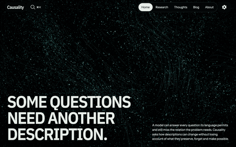

# gazette-theme-lattice

Lattice is the Gazette world used by Causality. Relations become legible through exact notation, orthogonal analytical forms and selective depth. The accepted field opens the inquiry; reading stays calm and precise. [WORLD.md](WORLD.md) records the accepted opening, nine axes, page ranges and motifs still to draw.

The [presentation package](presentation.toml) extends `gazette-theme-base` using the `lattice` values from `design-tokens`. Base owns shared behavior; the world supplies presentation, and the workspace supplies words, media and destinations. [Compositions](docs/compositions.md) describes the selectors, authoring forms and source bindings.

## Build and check

Bind `theme:lattice`, `theme:base` and the resources declared in `presentation.toml` in a Gazette workspace. Gazette’s `docs/theme-reference.md` describes the engine contract; Base’s `docs/start-a-world.md` describes fixture bindings and its README gives the shared verification command. This package is not a standalone site.

Change values at `design-tokens`, then run its `npm run build`, `npm run capture` and `npm run check:captures`. [Token provenance](tokens/SOURCE.md) and [font provenance](fonts/SOURCE.md) record captured inputs and licences. The delivered display, reading and system faces are WOFF2 resources.

Inspect all seven field compositions, including departure into the closing, reversed motion and complete captured stills. Run the neutral research fixture with explicit resource bindings when its forms change; inspect notation, tables and the reading tree. Cover light and dark, normal and reduced motion, wide and handheld layouts, opened controls and print. A successful build establishes neither visual continuity nor design acceptance. Start with [AGENTS.md](AGENTS.md).

## Licence

Lattice is licensed under the MIT License with an attribution term: a site built with it keeps a footer credit stating that it was made using Gazette, such as "Made using Gazette", linking to [rawthoughts.in/gazette](https://rawthoughts.in/gazette/), and a link to this repository. [LICENSE](LICENSE) gives the full terms and the files that keep their own. The fonts are under the SIL Open Font License 1.1, with each family's licence in [fonts](fonts/). The relation field's adapted shader kernels keep their MIT licence in [scripts/relation-LICENSE.txt](scripts/relation-LICENSE.txt).

The preview shows content from the publication this world was made for, which this repository does not license: footage and artwork purchased from a vendor under licence, and the portrait and publication art of [Harsh](https://getharsh.in). All rights reserved; not for reuse from this repository.
